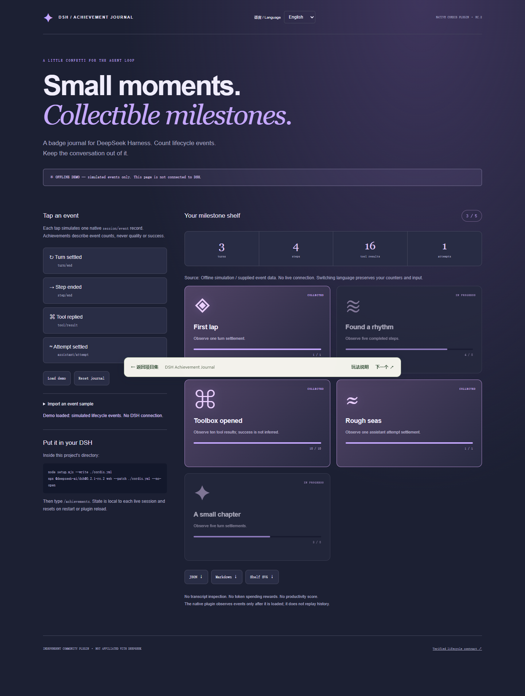
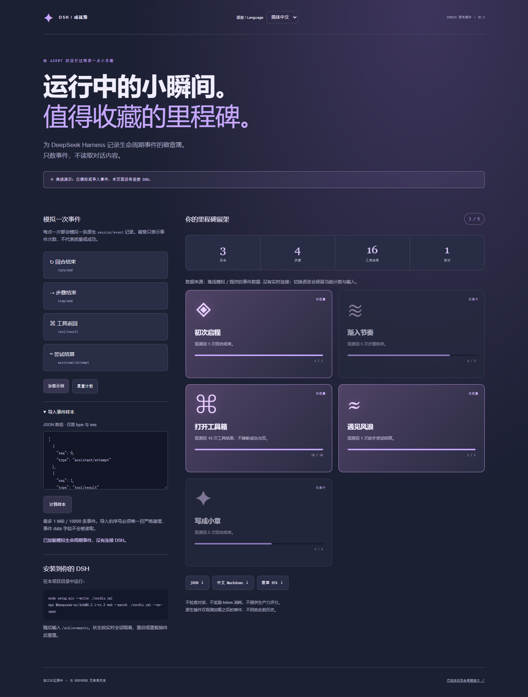

# DSH Achievement Journal
**Small moments. Collectible milestones.** A native DeepSeek Harness plugin that gives the agent loop a tiny badge shelf.

[简体中文](README.zh-CN.md) · MIT · Node.js 22+ · Zero plugin runtime dependencies



## Try it in a minute
With Git and Node.js 22+ installed, run:

```sh
git clone https://github.com/Euphoria2586/dsh-achievement-journal.git
cd dsh-achievement-journal
node cli.mjs serve
```

Open <http://127.0.0.1:4187>. You can also use **Code → Download ZIP**, extract it, and run `node cli.mjs serve` in that folder. The offline demo needs no account, API key or package install. Try the demo first; install into DSH below when you are ready.

## Install into DSH
This is a real Cordis plugin targeting **@deepseek-ai/dsh 0.2.1-rc.2**, not an MCP wrapper. From this directory:
```sh
node setup.mjs --write ./cordis.yml
npx @deepseek-ai/dsh@0.2.1-rc.2 web --patch ./cordis.yml --no-open
```
DSH itself is a separate host dependency. The setup script writes a Cordis insert patch with an absolute path to `plugin.mjs`; it refuses to overwrite an existing file. `node setup.mjs` prints the patch instead. If you move this project, regenerate the patch.

Inside a DSH chat:
```text
/achievements
/achievements json
/achievements reset
```
The plugin registers through `ctx.commands.register()` and observes `ctx.on('session/event', (session, event) => …)`. State is keyed by the receiving Session object in a WeakMap. No identifiers or conversation content are copied into reports.

## What the badges mean
| Badge | Trigger |
|---|---|
| First lap | One `turn/end` |
| Found a rhythm | Five `step/end` |
| Toolbox opened | Ten `tool/result` |
| Rough seas | One `assistant/attempt` |
| A small chapter | Five `turn/end` |

These are event counts, not correctness, safety, productivity or success scores. A tool result may represent an error, and a turn ending does not prove the task succeeded. No badge is based on tokens spent.

Only `type` and `seq` are examined; the `data` payload is never read. Live repeated or out-of-order sequence numbers do not increase counters. Only events observed after plugin activation/reset count; prior history is not replayed. State is in memory and disappears on restart, session disposal or plugin reload.

The command uses `recordInput: false`. DSH still owns its normal event logs and command-result history; this plugin does not erase host records.

## Offline demo and CLI
```sh
node cli.mjs serve
# Open http://127.0.0.1:4187
node cli.mjs inspect examples/events.json
node cli.mjs inspect examples/events.json --format md
node cli.mjs inspect examples/events.json --format svg > journal.svg
node --test
```
The web studio is explicitly **simulated, not a live DSH connection**. Click events to unlock badges or import a JSON event array. Imported samples must have unique, strictly increasing nonnegative integer `seq` and string `type` fields; bounds are 1 MiB and 10,000 events. Payloads are ignored. JSON, Markdown and SVG reports label their source as live, offline demo, or imported sample.

## Compatibility and validation
API contracts were checked against [DSH commit 687f282](https://github.com/deepseek-ai/deepseek-harness/blob/687f282e8625c6b8d11ff58211a90524be2e4317/docs/cookbook/extension-cookbook.md). The native plugin has also been loaded against real Cordis 4.0.5 and commands 0.2.1-rc.2 in the batch integration check, including command dispatch, session isolation and disposal. This is not a complete live-model end-to-end test.

Standalone `node --test` covers pure logic, no-payload access, sequence behavior, session isolation, cancellation, native registration contracts, setup output and loopback server boundaries. Pin your DSH version; release-candidate APIs may evolve.

Sources: [event lifecycle](https://github.com/deepseek-ai/deepseek-harness/blob/687f282e8625c6b8d11ff58211a90524be2e4317/docs/agent-lifecycle.md), [session API](https://github.com/deepseek-ai/deepseek-harness/blob/687f282e8625c6b8d11ff58211a90524be2e4317/packages/core/session/src/index.ts), [commands](https://github.com/deepseek-ai/deepseek-harness/blob/687f282e8625c6b8d11ff58211a90524be2e4317/packages/interaction/commands/src/index.ts). Checked 2026-10-22.

## Contribute
Add small, non-invasive milestones and tests. Do not infer success from a lifecycle event, collect transcript text, or introduce pressure to spend more tokens. See [launch kit](LAUNCH.md). Independent community project; not affiliated with DeepSeek.

## Chinese interface and reports
Use the language selector or open `?lang=zh` / `?lang=en`. Language changes preserve counters, imported input, validity and source provenance. With no valid URL parameter, English remains the default. No preference or data is persisted.

Native commands also accept a language suffix:
```text
/achievements zh
/achievements show zh
/achievements reset zh
/achievements json zh
```
Human reports and SVG labels can be Chinese; JSON field names and source identifiers remain stable. The studio distinguishes simulated events, imported samples and live plugin observations; changing language never changes that classification.

Optional browser regression: install Playwright separately (or set `PLAYWRIGHT_MODULE_PATH`) and run `node scripts/browser-smoke.mjs`. `PLAYWRIGHT_CHANNEL=msedge` can select an installed Edge. This verifies URL language initialization, input/state preservation, Chinese exports, invalid imports and 390 px layout without making external requests.



